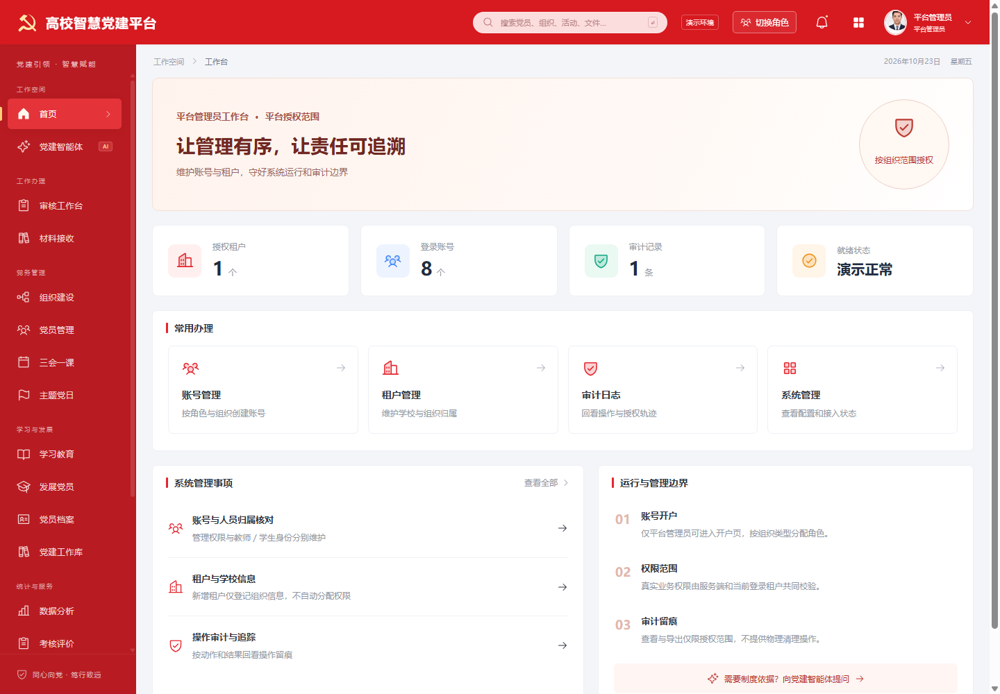

# 管理员导航检查

后续执行记录：平台管理员现已按用户新指定的六入口完成，详见 [设计与验收](platform-admin-design.md)。下文保留最初导航检查时的截图和建议，不代表当前界面。

2026-10-23，基于当前本地预览实际截图和 DOM 检查。只评估导航结构，没有调整菜单或权限。

1. 校级管理员：可访问，但入口过密。17 个常驻功能；菜单滚动区域高 838px、内容高 1004px，需要滚动寻找底部入口。
2. 平台管理员：可访问，职责与导航不一致。19 个常驻功能；内容高 1136px。首页主要围绕账号、租户和审计，侧栏仍展开完整党务业务。

已有角色过滤、图标和分段标题有助于定位，但分段没有降低同时展示的功能数量。党员管理与党员档案独立平铺，个人中心又与头像入口重复。

建议校级导航按七类组织：工作台（总览、待办、审核、材料接收）；组织与党员（组织、名册、档案、发展）；组织生活（三会一课、主题党日）；学习与考核；党建智能体（问答、制度资料）；数据分析；系统管理（配置、审计）。当前模块展开二级菜单，其余折叠；个人中心归入头像菜单。二级页面继续执行既有权限。

平台导航主要展示工作台、账号权限、租户管理、审计日志、系统设置；低频授权业务可从工作台统一入口进入。此建议尚未实施，不改变现有业务授权。

截图显示需要滚动寻找功能的可发现性风险；本次没有测试键盘、读屏或全部响应式状态，不对无障碍合规作结论。

