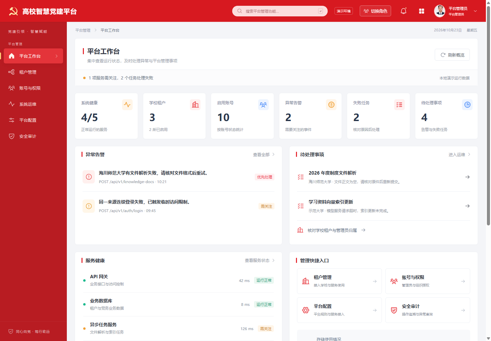
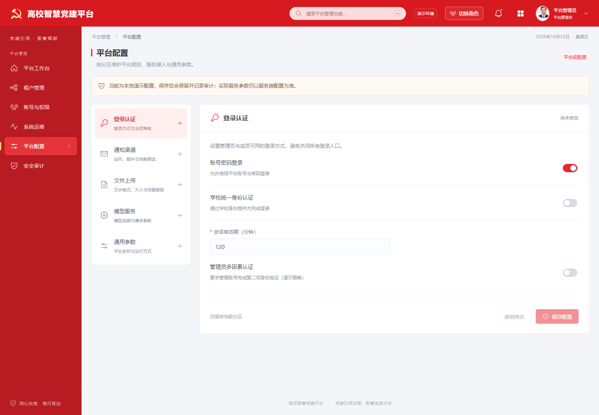

# 平台管理员六入口设计与验收

更新：2026-10-23。范围为平台管理员的前端、本地演示流程及参考后端接口适配。导航严格按用户提供顺序展示六项；学校业务继续使用学校角色的导航，个人资料位于头像菜单。

## 页面与主要流程

| 一级入口 | 已实现内容 |
| --- | --- |
| 平台工作台 | 服务健康、学校与账号数量、异常告警、失败任务、待处理事项、学校概览；告警和待办可跳到对应运维页签 |
| 租户管理 | 学校开通、搜索筛选、基本信息、启停、同校管理员指定、本地演示服务用量 |
| 账号与权限 | 按租户管理管理员开户、各类账号信息编辑（姓名、业务角色、组织范围、启停状态及密码）、密码重置、会话查询和撤销演示 |
| 系统运维 | 服务状态、接口异常、文件和异步任务、失败重试演示、存储、备份记录、创建记录与恢复演练 |
| 平台配置 | 认证、通知、上传、模型、通用参数五个分区；验证、保存、撤销、未保存切换确认和保存时间 |
| 安全审计 | 登录、权限变更、关键操作、材料访问导出、异常访问；租户、结果、日期与关键词筛选，详情和导出 |

平台页面按需加载。现有红色顶栏与侧栏、浅灰工作区、白色卡片及表格样式保持一致。桌面侧栏可完整显示六项，手机使用导航抽屉；宽表格在自身容器内滚动。

## 演示中的具体行为

- 学校和账号启停、角色授权、材料访问及运维操作写入演示审计摘要。禁止当前平台账号自锁，禁止移除学校最后一位有效管理员。
- 各类账号的列表与详情均可进入属性编辑；登录标识及所属租户固定，本人档案关联保留。当前管理员可修改姓名与密码，修改密码后重新登录；修改角色、组织、状态或密码会撤销受影响的演示会话。仅修改姓名不会撤销会话。
- 学校管理员从“校级管理 → 本校账号管理”编辑本校账号，管理范围固定所属学校，不能授予平台角色。账号开户与租户管理仍由平台管理员办理。
- 新学校不继承示范学校的成员、组织、会议、材料或提醒。账号与所属租户都必须启用才能登录；停用身份不能通过刷新或演示身份选择器恢复。
- 账号编辑的新密码与确认字段初始为空且隐藏，留空不修改；显示按钮仅展示本次输入。演示改密保存加盐校验值，修改后旧密码失效，保留累计自主改密次数；明文和校验值不进入审计。模型配置不接收密钥，真实凭据由服务端管理。
- 上传大小与格式配置会作用于演示个人材料的实际校验；平台名称会更新顶栏。
- 备份与恢复演示保存记录并要求明确确认，恢复演练不替换实际业务数据。

## 真实后端适配与边界

根据参考仓库的 admin、governance、health、identity_service 源码核对接口。没有调用真实管理变更。

| 能力 | 真实模式 |
| --- | --- |
| 学校开通、改名、启停 | 已适配 GET/POST/PATCH /admin/tenants；不向禁止额外字段的接口提交演示联系人资料 |
| 账号创建、改权、停用、密码重置 | 已适配 /admin/users 的 GET/POST/PATCH，目标学校 tenant_id 在查询参数，角色和组织由后端验证 |
| 学校管理员 | 可通过学校账号的 school_admin 角色与 school 组织授权维护；主要负责人字段没有专用接口 |
| 健康诊断 | /admin/health/ready 普通 JSON，保留 HTTP 503 检查结果；共享令牌刷新并丢弃换号期间的旧响应 |
| 运行汇总、任务、异常 | /admin/operations 为当前租户汇总，/admin/jobs 为本人提交任务，/admin/run-logs 为授权运行日志 |
| 配置 | 已适配通用检索参数、版本化模型路由和保留策略；通知渠道只读 |
| 审计 | 按授权范围查询与分页，导出真实 ZIP 对账包 |
| 缺少的接口 | 学校服务用量、会话列表与指定撤销、任务原地重试、容量字节、备份恢复、认证方式及上传上限写入、通知凭据与模型 URL/密钥 |

缺少接口的项目在真实模式明确显示未接入、只读或不可保存，不使用演示数据补齐，不伪造成功。运行概览明确采用当前后端授权范围，不把当前租户的指标声称为全平台统计。

账号编辑字段按参考后端 [UserUpdate](https://github.com/jaimelove67/dangjian-agent/blob/b190fcb9464c2fb2a9116b469b5a0a4d2a4cd274/app/schemas/governance.py#L132) 核对：姓名、角色、组织、启停状态与密码；登录账号不在更新字段内。组织类型匹配 [ROLE_ORG_TYPES](https://github.com/jaimelove67/dangjian-agent/blob/b190fcb9464c2fb2a9116b469b5a0a4d2a4cd274/app/services/identity_service.py#L23)，组织员允许院系或支部范围。[学校账号维护接口](https://github.com/jaimelove67/dangjian-agent/blob/b190fcb9464c2fb2a9116b469b5a0a4d2a4cd274/app/api/v1/governance.py#L255) 使用 `admin.identity` 权限，后端校验租户边界并对新密码进行哈希；界面只发送本次非空的新密码，不发送确认字段。真实会话撤销仍需后端专用能力，不能以本地演示记录代替。

## 验证

- npm test：40 条通过，含角色范围、迁移幂等、停用身份、新学校隔离、上传规则、配置校验、管理员保护，以及健康请求的刷新 / 503 / 换号边界。
- 集成浏览器：7 组通过，包含六项导航顺序、六页桌面、告警跳转、页面权限、上传配置实际联动、六页 390px、学校停用登录与提醒隔离；应用异常为 0。
- 租户 / 账号 / 审计独立浏览器流程：12 组通过；契约与边界断言 19 项通过。
- 运维 / 配置独立浏览器：10 项断言通过，包含重试、备份创建、恢复确认及业务数据保持、分区保存、未保存提示和手机布局。
- 真实模式代码路径：合成接口检查通过六页与配置分区，包含真实形状的运行汇总和 HTTP 503 就绪结果；未发出真实写请求。这不等于真实后端联调。
- 生产构建通过，平台页面分为独立加载产物。打包检查及最新状态见主核验报告。
- 账号改密与学校账号编辑补充验证：64 条自动化测试通过，11 组账号改密浏览器流程及 8 组原有属性编辑回归通过，4 项真实模式合成接口检查通过，Sites 打包测试 4 条通过。合成检查未连接真实账号服务，未执行真实账号变更。

截图与集成结果位于 screenshots/platform-admin/。已逐页查看桌面截图，并检查手机布局。后端、数据库、真实模型、备份设施、真实学校权限仍未进行联调或业务验收。

